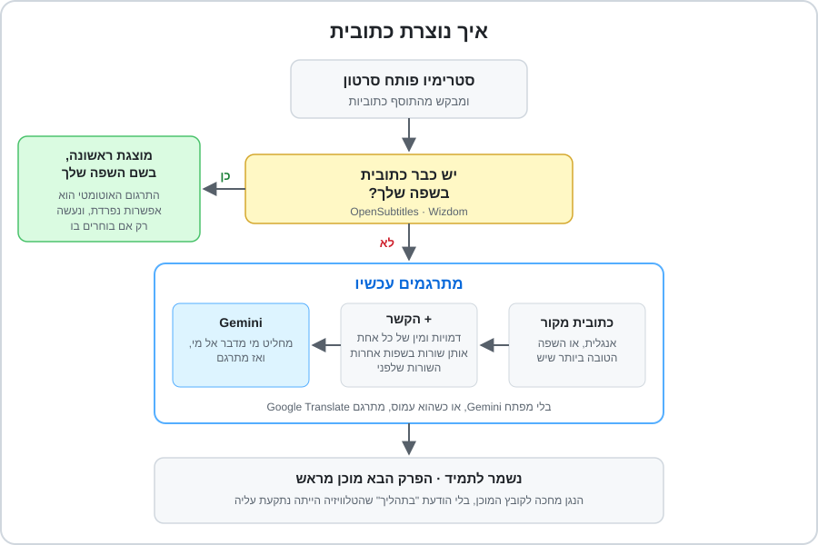
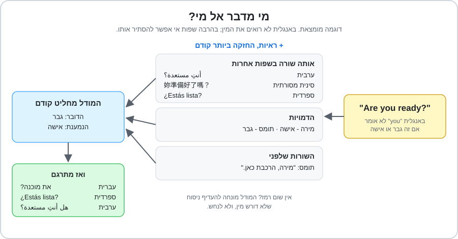

<div dir="rtl">

# מתרגם כתוביות AI לסטרימיו — בכל שפה, עם זכר ונקבה נכונים

[English](README.md) · **עברית**

תוסף ל-[Stremio](https://www.stremio.com/) שמריצים על שרת משלך. הוא נותן כתוביות בשפה שלך
לכל סרט, סדרה ואנימה. כשכבר יש כתובית בשפה שלך, היא מוצגת ראשונה. כשאין, התוסף מתרגם בעזרת
המודל Gemini של גוגל, עם מפתח API שלך, על השרת שלך.

חינם לשימוש אישי ולא מסחרי ([רישיון](#רישיון)).

התוסף נבנה לעברית ועובד בכל שפה ש-Gemini יודע לכתוב. הוא מקפיד במיוחד על משהו שתרגום מכונה
נוטה לפספס: **זכר ונקבה**. באנגלית "you" לא אומר אם פונים לגבר או לאישה, ובעברית, ערבית,
ספרדית, רוסית ועוד הרבה שפות צריך לדעת את זה כמעט בכל משפט.



## תוכן

- [מה הוא עושה](#מה-הוא-עושה)
- [זכר ונקבה](#זכר-ונקבה)
- [התחלה מהירה](#התחלה-מהירה)
- [בחירת שפה](#בחירת-שפה)
- [הגדרות](#הגדרות)
- [עלויות](#עלויות)
- [פרטיות ואבטחה](#פרטיות-ואבטחה)
- [מגבלות](#מגבלות)
- [מדידת איכות התרגום](#מדידת-איכות-התרגום)
- [פיתוח](#פיתוח)
- [מקורות מידע](#מקורות-מידע)
- [רישיון](#רישיון)

## מה הוא עושה

- **קודם כתוביות שכבר קיימות.** אם יש כבר כתובית בשפה שלך (ב-OpenSubtitles, ולעברית גם
  ב-Wizdom), היא מופיעה ראשונה בשם השפה שלך ונבחרת לבד. התרגום האוטומטי עדיין מוצע כאפשרות
  נפרדת, ונעשה רק אם בוחרים בו. זה שימושי כשהכתובית הקיימת לא מסונכרנת לגרסה שצופים בה.
- **תרגום AI כשאין כלום.** התוסף לוקח את כתובית המקור הטובה ביותר (אנגלית, אם יש), מתרגם
  אותה ב-Gemini ומציג אותה בשם השפה שלך, כך שהנגן בוחר בה לבד.
- **עובד בטלוויזיה.** אפליקציות טלוויזיה מורידות כתובית פעם אחת ושומרות את מה שקיבלו. לכן
  התוסף אף פעם לא שולח הודעת "בתהליך": הבקשה נשארת פתוחה עד שהתרגום מוכן (בדרך כלל 5-15
  שניות לפרק).
- **נשמר לתמיד.** כל תרגום נשמר בדיסק של השרת. פתיחה חוזרת של הפרק, מכל מכשיר, מיידית. בזמן
  הצפייה הפרק הבא מתורגם ברקע.
- **גם אנימה.** עובד עם מזהים רגילים (`tt…`) ועם מזהי אנימה (`kitsu:`, `mal:`, `anilist:`,
  `anidb:`), כך שכתוביות מופיעות גם לסרטונים שנפתחו מקטלוגים של אנימה.
- **גיבוי.** בלי מפתח Gemini, או כשהוא עמוס, התוסף משתמש ב-Google Translate (תרגום פשוט יותר,
  שלא מבחין בזכר ונקבה). אפשר לכבות אותו.

## זכר ונקבה



כל חלק של שורות שנשלח למודל מגיע עם ראיות, מהחזקה לחלשה:

1. **אותן שורות בשפות שמבדילות בין זכר לנקבה**, כשיש קבצים כאלה לסרטון: תרגום קיים בשפה
   שלך, ערבית או עברית, סינית מסורתית (יש בה תו נפרד ל"את"), שפות סלאביות, שפות רומאניות,
   והיפנית המקורית של אנימה. קובץ אחד מכל משפחת שפות, עד שלושה. קובץ נכנס רק אם התזמון שלו
   תואם באופן מדיד לכתובית המקור: רמז מהרגע הלא נכון גרוע מבלי רמז.
2. **רשימת הדמויות עם המין של כל אחת**, מהמאגר [AniList](https://anilist.co), לאנימציה. עובד
   גם לסדרות חדשות לגמרי שהמודל לא מכיר.
3. **השורות שלפני**, כדי לעקוב מי מדבר אל מי.

המודל חייב לקבוע לכל שורה מי מדבר (`m`/`f`) ואל מי (`m`/`f`/כמה אנשים) **לפני** שהוא כותב את
התרגום. כשאין שום רמז, הוא מונחה להעדיף ניסוח שלא דורש מין, ולא לנחש.

**מה נמדד בעברית** (21.11.2026): שישה סרטי ופרקי אנימה שיש להם תרגום עברי אנושי, 3,127
שורות. לכל מילה שמשתנה לפי מין בודקים: האם המכונה בחרה באותו מין כמו המתרגם האנושי? כ-170 מקרי
נקבה וכ-200 מקרי זכר.

| | נקבה נכון | זכר נכון |
|---|---|---|
| לפני (הנחיית תרגום רגילה) | 86% | 86% |
| הנחיית מין + רשימת דמויות | 89% | 89% |
| + אותן שורות בשפות אחרות | 93% | 89% |

השיפור מרוכז במקום שבו ההנחיה הרגילה הייתה חלשה: בסרט הקשה ביותר הנקבה עלתה מ-54% ל-70%
(רשימת דמויות) ול-86% (עם שפות אחרות). בסרט בודד התוצאה זזה בכמה מקרים לכאן או לכאן; רק
הסכום יציב. נוסו גם "חשיבה" עמוקה יותר של המודל ומודל חדש יותר, ולא שיפרו מספיק כדי להצדיק את
ההמתנה הנוספת.

שפות יעד אחרות מקבלות את אותה הנחיה עם השם והניסוח שלהן. ספרדית וערבית נוסו דרך Gemini ויצאו
בלשון הנכונה בבדיקות נקודתיות; שאר השפות המובנות לא הורצו, ו**אף אחת לא נמדדה**. בשפות בלי
מין דקדוקי (אנגלית, פינית, טורקית, הונגרית, אינדונזית ועוד) שלבי הזכר והנקבה לא מוסיפים כלום.

## התחלה מהירה

צריך שלושה דברים: מקום להריץ שרת Node.js קטן, מפתח Gemini משלך, וסטרימיו.

### 1. מפתח Gemini

יוצרים מפתח ב-[Google AI Studio](https://aistudio.google.com/app/api-keys). המסלול החינמי
מספיק לשימוש אישי. שומרים את המפתח פרטי: הוא נכנס רק להגדרות של השרת, אף פעם לא לקוד.

### 2. הרצת השרת

**ב-Railway.** הכותב מריץ אותו שם, ומעלה מהטרמינל (`railway up` בתיקיית הפרויקט). המסלול דרך
GitHub שלמטה הוא המסלול הרגיל של Railway, ולא הורץ בדיוק כך:

1. עושים Fork למאגר הזה ב-GitHub.
2. ב-[Railway](https://railway.com): *New Project ← Deploy from GitHub repo* ← בוחרים את
   ה-Fork. הקובץ `railway.json` כבר מגדיר את פקודת ההפעלה ובדיקת תקינות.
3. מוסיפים לשירות **Volume** (דיסק קבוע) שמחובר ב-`/data`, כדי שהתרגומים ישרדו הפעלה מחדש.
4. ב-**Variables** של השירות מגדירים:

   | משתנה | ערך |
   |---|---|
   | `ADDON_SECRET` | מחרוזת אקראית ארוכה (ראו למטה) |
   | `GEMINI_API_KEY` | המפתח שלך |
   | `CACHE_DIR` | `/data/cache` |
   | `TARGET_LANG` | השפה שלך, למשל `heb`, `spa`, `ara` (ראו [למטה](#בחירת-שפה)) |

5. *Settings ← Networking ← Generate Domain*. פותחים `https://<הכתובת>/health` ומקבלים `ok`.

ליצירת מחרוזת סודית:

```bash
node -e "console.log(require('crypto').randomBytes(20).toString('hex'))"
```

**בכל מחשב עם Node.js 22 ומעלה** (שרת בבית, שרת וירטואלי):

```bash
git clone <הכתובת של ה-Fork שלך>
```

```bash
cp .env.example .env
```

ממלאים את `.env` (לפחות `ADDON_SECRET` ו-`GEMINI_API_KEY`), ואז:

```bash
npm run start:env
```

אין מה להתקין. השרת מאזין ב-`PORT` (ברירת מחדל 7860). סטרימיו במכשירים אחרים צריך להגיע אליו
ב-HTTPS, אז שמים אותו מאחורי שרת מתווך (reverse proxy) או מנהרה עם תעודה.

### 3. התקנה בסטרימיו

כתובת התוסף שלך:

```
https://<הכתובת>/<ADDON_SECRET>/manifest.json
```

בסטרימיו נכנסים ל-**Addons**, מדביקים את הכתובת בתיבת החיפוש ומתקינים. התוסף נשמר בחשבון
הסטרימיו, ולכן מופיע בכל מכשיר שמחובר אליו, כולל טלוויזיות.

אחר כך, **בכל מכשיר**, מגדירים *Settings ← Player ← Default subtitles language* לשפה שלך.
ההגדרה הזו נשמרת בכל מכשיר בנפרד ולא עוברת ביניהם. בטלוויזיה סוגרים ופותחים את סטרימיו פעם אחת
אחרי ההתקנה.

## בחירת שפה

שרת אחד מתרגם לשפה אחת, שנקבעת ב-`TARGET_LANG` (קוד ISO 639-2, כמו ש-OpenSubtitles משתמש).
מובנות:

`heb` עברית · `ara` ערבית · `per` פרסית · `spa` ספרדית · `fre` צרפתית · `ita` איטלקית ·
`por` פורטוגזית · `pob` פורטוגזית ברזילאית · `ron` רומנית · `ger` גרמנית · `nld` הולנדית ·
`rus` רוסית · `pol` פולנית · `cze` צ'כית · `slo` סלובקית · `bul` בולגרית · `srp` סרבית ·
`hrv` קרואטית · `bos` בוסנית · `slv` סלובנית · `mac` מקדונית · `ell` יוונית · `tur` טורקית ·
`hun` הונגרית · `fin` פינית · `est` אסטונית · `swe` שוודית · `dan` דנית · `nor` נורווגית ·
`alb` אלבנית · `ind` אינדונזית · `may` מלאית · `vie` וייטנאמית · `tha` תאית · `ben` בנגלית ·
`tam` טמילית · `sin` סינהלית · `kor` קוריאנית · `jpn` יפנית · `zho` סינית מפושטת ·
`zht` סינית מסורתית · `eng` אנגלית

שפות שנכתבות מימין לשמאל (עברית, ערבית, פרסית) מקבלות סימני כיוון בכל שורה, כך שסימני הפיסוק
נופלים בצד הנכון בכל נגן.

**שפה שאינה מובנית** מגדירים במשתנים:

| משתנה | משמעות |
|---|---|
| `TARGET_LANG` | הקוד שמקורות הכתוביות משתמשים בו לשפה. סטרימיו בוחר כתוביות לפי הקוד הזה |
| `TARGET_LANG_NAME` | שם השפה באנגלית, כמו שהמודל מקבל אותו (חובה) |
| `TARGET_LANG_LABEL` | שם קצר שמשמש בתוך הבקשה למודל |
| `TARGET_LANG_GOOGLE` | הקוד שלה ב-Google Translate. ריק = בלי גיבוי |
| `TARGET_LANG_RTL` | `on` לכתב מימין לשמאל |
| `ADDON_NAME`, `MACHINE_LABEL`, `FAILED_NOTICE` | טקסטים שהצופה רואה, בשפה שלך |

כדי שזה יהיה קבוע, מוסיפים רשומה ל-[`src/language/profiles.js`](src/language/profiles.js).
רשומת העברית שם מראה כל שדה ששפה יכולה להגדיר.

רוצים שתי שפות? מריצים שני שרתים (כל אחד עם סוד ודיסק משלו), ומתקינים את שני התוספים.

## הגדרות

כל ההגדרות הן משתני סביבה. [`.env.example`](.env.example) מפרט את כולם עם הסבר.

| משתנה | ברירת מחדל | מה הוא עושה |
|---|---|---|
| `ADDON_SECRET` | - | **חובה.** חלק מכתובת התוסף, לפחות 16 תווים |
| `GEMINI_API_KEY` | - | מפתח Gemini שלך. בלעדיו עובד רק מתרגם הגיבוי |
| `GEMINI_MODEL` | `gemini-3.1-flash-lite` | המודל שמתרגם |
| `TARGET_LANG` | `heb` | השפה שמתרגמים אליה |
| `CACHE_DIR` | `./cache` | איפה נשמרים התרגומים. צריך דיסק קבוע |
| `GOOGLE_FALLBACK` | `on` | Google Translate כגיבוי |
| `HINT_FILES` | `3` | כמה קבצים בשפות אחרות נשלחים כרמזים לזכר ונקבה (`0` = כבוי) |
| `CAST_LOOKUP` | `on` | רשימת דמויות עם מין מ-AniList, לאנימציה |
| `WIZDOM_ADDON_URL` | התוסף הציבורי של Wizdom | מקור נוסף לעברית קיימת. `off` מכבה |
| `DIAG_ROUTES` | `off` | נתיבי בדיקה לכלי המדידה. להשאיר כבוי אם לא מודדים |
| `ADDON_ID` | `community.ai-subtitles.<lang>` | קובע את מזהה התוסף |
| `MAX_VARIANTS` | `3` | כמה קובצי מקור חלופיים מוצעים |
| `HOLD_TIMEOUT_MS` | `110000` | כמה זמן הורדה מחכה לתרגום |
| `PRETRANSLATE_DELAY_MS` | `45000` | מתי מתחיל תרגום הפרק הבא |
| `TRANSLATE_CONCURRENCY`, `CHUNK_SIZE`, `GEMINI_TIMEOUT_MS`, `PORT` | | כיוונון |

בדיקות לבעלים, מאחורי הקוד הסודי:

- `https://<הכתובת>/health` — מחזיר `ok`, בלי קוד סודי.
- `https://<הכתובת>/<ADDON_SECRET>/status` — מצב המתרגם, תרגומים שמורים, אירועים אחרונים.
- `https://<הכתובת>/<ADDON_SECRET>/selftest` — מתרגם שתי שורות ומראה איזה מנוע ענה.

## עלויות

נבדק ב-21.11.2026. מחירים משתנים; כדאי לבדוק בדפים של הספקים.

- **Gemini.** [המסלול החינמי](https://ai.google.dev/gemini-api/docs/pricing) לא עולה כלום,
  בתוך מגבלות הקצב שלו. במחיר בתשלום של `gemini-3.1-flash-lite` (0.25 דולר למיליון טוקנים
  נכנסים, 1.50 דולר למיליון יוצאים), פרק של כ-350 שורות משתמש בכ-12-30 אלף טוקנים נכנסים
  ו-13-15 אלף יוצאים: **בערך 2-3 סנט**. סרט שלם פי 3-4. כל תרגום נעשה פעם אחת ונשמר.
- **אירוח.** השרת קטן (כ-110MB זיכרון, כמעט בלי מעבד כשהוא לא מתרגם). ב-[Railway](https://railway.com/pricing)
  השרת של הכותב צרך כ-0.13 דולר בשבוע הראשון לשימוש אישי (שימוש בלבד; דמי מנוי, אם יש, בנפרד). מתאים כל שרת שפועל תמיד עם כמה מאות
  MB זיכרון.
- כל השאר (OpenSubtitles דרך התוסף של סטרימיו, Cinemeta, AniList, Wizdom) בחינם.

## פרטיות ואבטחה

- **כתובת התוסף היא הסיסמה.** מי שמחזיק בה יכול להשתמש בשרת שלך ולבזבז את מכסת ה-Gemini שלך.
  לא לפרסם אותה. קוד סודי שגוי מקבל את אותו "לא נמצא" כמו דף שלא קיים.
- **מפתחות נשארים בהגדרות השרת.** לא מכניסים את `.env` לגיט (הוא ב-`.gitignore`), ובדיקה
  (`npm test`) נכשלת אם קובץ כלשהו במאגר נראה כאילו יש בו מפתח.
- **מה יוצא מהשרת:** טקסט הכתוביות נשלח ל-Gemini (או ל-Google Translate); שמות סרטים וסדרות
  ל-Cinemeta ול-AniList; מזהי סרטונים, ושם הקובץ, הגודל וה-hash שהנגן מדווח על הסרטון (כדי למצוא את הגרסה המדויקת),
  ל-OpenSubtitles ול-Wizdom. שום מידע עליך או על המכשירים
  שלך לא נשלח. במסלול החינמי של Gemini גוגל רשאית להשתמש בתוכן לשיפור המוצרים שלה, לפי התנאים שלה.
- **נתיבי הבדיקה כבויים כברירת מחדל.** `DIAG_ROUTES=on` מאפשר למי שמחזיק בכתובת להריץ כל הנחיה
  על המפתח שלך. מדליקים רק בזמן מדידה.
- הגיבוי משתמש בנקודת הקצה הציבורית של Google Translate, שאינה API רשמי. `GOOGLE_FALLBACK=off`
  משאיר רק את Gemini.

## מגבלות

- **זכר ונקבה לא יהיו מושלמים.** כתוביות לא אומרות מי מדבר, והמודל מסיק את זה. לאנימה חדשה יש
  בדרך כלל רשימת דמויות ולפעמים סינית מסורתית; ערבית או רוסית כמעט אין. לסדרות שאינן אנימציה
  אין רשימת דמויות.
- **רק עברית נמדדה.** שפות אחרות עובדות באותה שיטה, אבל אין להן מספרים; מלבד ספרדית וערבית
  הן לא נוסו.
- **"קיימת" אינו "מקצועית".** הרשימות לא אומרות אם כתובית קיימת נעשתה בידי אדם או מכונה, והיא
  עלולה לא להתאים לגרסה שצופים בה.
- **בלי מקור אין תרגום.** פרק שאין לו כתובית באף שפה (לרוב פרק ששודר זה עתה) לא יקבל כלום עד
  שתופיע.
- **תרגום שנכשל מציג שורת הודעה אחת** באותה צפייה. בוחרים כתובית אחרת וחוזרים, או מנסים שוב
  אחרי דקה.
- **השרת לא רושם אם הנגן הוריד את הקובץ**, רק שנפתח סרטון ושנעשה תרגום.

## מדידת איכות התרגום

`tools/eval` משווה שיטת תרגום לתרגום אנושי של אותו סרטון, מילה אחרי מילה, מבחינת זכר ונקבה.
כרגע יש בו סרטוני בדיקה ורשימת מילים לעברית בלבד.

```bash
node tools/eval/run.mjs silent base,cast+alt lines=800
```

הקריאות למודל רצות על השרת שלך דרך נתיבי הבדיקה, כך שהמפתח לא יוצא ממנו: מדליקים שם
`DIAG_ROUTES=on`, ומכוונים את הכלים לשרת עם `ADDON_URL` (`https://<הכתובת>/<ADDON_SECRET>`) או
עם קובץ `tools/local.json` (ראו `tools/local.example.json`). כדי למדוד שפה אחרת צריך סרטונים
עם תרגום אנושי בשפה הזו ורשימה של זוגות המילים שלה לפי מין (ראו את הרשימה העברית
ב-`tools/eval/genderPairs.js`).

## פיתוח

```bash
npm test
```

אין תלויות חיצוניות, Node.js 22 ומעלה. הבקשה למודל בעברית קבועה תו אחרי תו בבדיקה
`test/hebrew-golden.test.js`, כי זה מה שנמדד: מי שמשנה את הניסוח המשותף יקבל מהבדיקה הודעה
למדוד שוב.

| תיקייה | אחריות |
|---|---|
| `src/server.js`, `src/http/` | השרת, ניתוב הכתובות, בדיקת הקוד הסודי |
| `src/routes/` | טיפול בכל סוג בקשה: רשימת כתוביות, קובץ כתובית, מצב |
| `src/language/` | שפת היעד: הפרופילים המובנים וכל מה שתלוי בהם |
| `src/stremio/` | מזהי סרטונים, והמרת מזהי אנימה למזהה IMDb |
| `src/sources/` | מה קיים לסרטון: כתוביות מקור, תרגומים קיימים |
| `src/context/` | מה מתרגמים: שם (Cinemeta) ודמויות עם מין (AniList) |
| `src/hints/` | אותן שורות בשפות שמבדילות זכר ונקבה: בחירת קבצים ויישור לפי זמן |
| `src/translate/` | חלוקה לחלקים, הבקשה למודל, Gemini, והגיבוי של Google Translate |
| `src/jobs/` | עבודה אחת לכל קובץ, תרגום מראש של הפרק הבא, מתי מתרגמים מחדש קובץ שמור |
| `src/srt/`, `src/cache/` | קריאה וכתיבה של קובצי כתוביות; שמירת תרגומים |
| `tools/` | כלים לבעלים: בדיקת שרת חי, מדידת איכות |

## מקורות מידע

הכתוביות מגיעות מ-[OpenSubtitles](https://www.opensubtitles.org) דרך תוסף OpenSubtitles v3 של
סטרימיו עצמו, ולעברית גם מ-[Wizdom](https://wizdom.xyz). שמות מגיעים מ-Cinemeta של סטרימיו,
דמויות מ-[AniList](https://anilist.co), והמרת מזהי אנימה מהתוסף Anime Kitsu. כדאי לכבד את
התנאים של כל שירות ולהשתמש לשימוש אישי.

## רישיון

[PolyForm Noncommercial 1.0.0](LICENSE.md). הזכויות שמורות ל-yoankatz, 2026.

- **מותר, בחינם:** להשתמש בקוד, לשנות אותו ולהפיץ אותו לשימוש אישי ולשאר מטרות לא מסחריות,
  כולל עמותות, מוסדות חינוך וגופים ציבוריים.
- **אסור:** כל שימוש מסחרי, למשל למכור אותו או להפעיל עליו שירות בתשלום.
- **מי שמפיץ אותו** מעביר הלאה את נוסח הרישיון ואת שורת `Required Notice` שבראש
  [LICENSE.md](LICENSE.md).

בגלל האיסור על שימוש מסחרי, זה רישיון "קוד גלוי" ולא "קוד פתוח" במובן הרשמי. לרישיון מסחרי
פונים לכותב דרך GitHub.

הרישיון חל רק על הקוד הזה. לשירותים שהוא משתמש בהם (Gemini, OpenSubtitles, Wizdom, AniList,
Cinemeta) יש תנאים משלהם, וכל משתמש כפוף להם.

</div>
