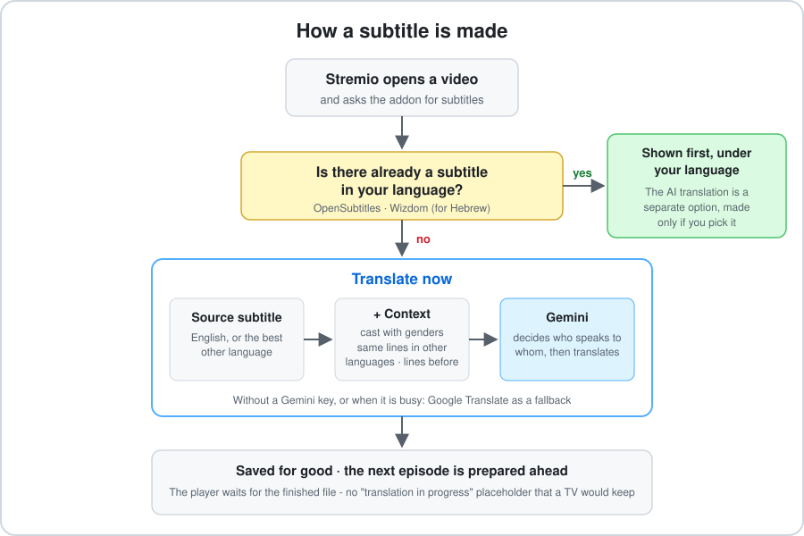
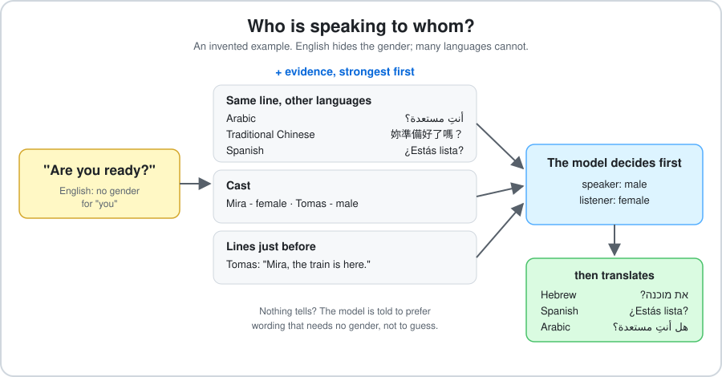

# Stremio AI Subtitle Translator — any language, with gender right

**English** · [עברית](README.he.md)

A self-hosted [Stremio](https://www.stremio.com/) addon that gives you subtitles in your
language for any movie, series or anime. When a subtitle in your language already exists, it
shows that one first. When none exists, it translates one with Google's Gemini model, using
your own API key, on your own server.

Free for personal, non-commercial use ([licence](#licence)).

It was built for Hebrew and works for any language Gemini can write. It pays particular
attention to something machine translation usually gets wrong: **grammatical gender**. English
"you" says nothing about whether a man or a woman is spoken to, while Hebrew, Arabic, Spanish,
Russian and many other languages need to know in almost every sentence.



## Contents

- [What it does](#what-it-does)
- [Getting gender right](#getting-gender-right)
- [Quick start](#quick-start)
- [Choosing the language](#choosing-the-language)
- [Settings](#settings)
- [Costs](#costs)
- [Privacy and security](#privacy-and-security)
- [Limitations](#limitations)
- [Measuring translation quality](#measuring-translation-quality)
- [Development](#development)
- [Data sources](#data-sources)
- [Licence](#licence)

## What it does

- **Existing subtitles first.** If a subtitle in your language already exists (OpenSubtitles,
  and Wizdom for Hebrew), it is listed first under your language and picked automatically.
  The AI translation is still offered as a separate entry, and is only made if you choose it.
  That helps when the existing file is out of sync with your copy of the video.
- **AI translation when nothing exists.** The addon takes the best source subtitle (English if
  there is one), translates it with Gemini and lists it under your language, so the player
  picks it by itself.
- **Works on TVs.** TV apps download a subtitle once and keep whatever came back. So the addon
  never sends a "translation in progress" placeholder: the request is held open until the
  translation is finished (usually 5-15 seconds for an episode).
- **Saved for good.** Every translation is stored on the server's disk. Opening the episode
  again, on any device, is instant. While you watch, the next episode is translated in the
  background.
- **Anime included.** Works with regular ids (`tt…`) and anime ids (`kitsu:`, `mal:`,
  `anilist:`, `anidb:`), so subtitles also appear for videos opened from anime catalogues.
- **A fallback.** Without a Gemini key, or when Gemini is busy, Google Translate is used
  instead (plainer, and blind to gender). It can be switched off.

## Getting gender right



Every batch of lines sent to the model carries evidence, strongest first:

1. **The same lines in languages that mark gender**, when such files exist for the video:
   an existing translation in your language, Arabic or Hebrew, Traditional Chinese (it has a
   separate character for a female "you"), Slavic languages, Romance languages, and the
   original Japanese of anime. One file per language family, up to three. A file is used only
   if its timing provably matches the source subtitle - a hint from the wrong moment is worse
   than none.
2. **The cast with each character's gender**, from [AniList](https://anilist.co), for
   animation. This also works for brand-new shows the model has never heard of.
3. **The lines just before**, to follow who is talking to whom.

The model must then state, for every line, who speaks (`m`/`f`) and to whom (`m`/`f`/several)
**before** it writes the translation. When nothing tells, it is told to prefer wording that
needs no gender rather than guess.

**Measured for Hebrew** (21 Nov 2026): six anime films and episodes that have a human Hebrew
translation, 3,127 lines; for each gendered word, did the machine pick the same gender as the
human translator? About 170 feminine and 200 masculine cases.

| | feminine right | masculine right |
|---|---|---|
| Before (plain translation prompt) | 86% | 86% |
| Gender prompt + cast list | 89% | 89% |
| + the same lines in other languages | 93% | 89% |

The gain is concentrated where the plain prompt was weak: on the hardest film, feminine forms
went from 54% to 70% (cast list) and 86% (with other languages). Single films move by a few
cases either way; only the total is stable. More model "thinking" and a newer model were also
tried and did not help enough to justify the extra wait.

Other target languages use the same request with their own name and wording. Spanish and
Arabic were tried through Gemini and came out with the right gender in spot checks; the other
built-in languages have not been run, and **none was measured**. For languages without
grammatical gender (English, Finnish, Turkish, Hungarian, Indonesian and others) the gender
steps add nothing.

## Quick start

You need three things: a place to run a small Node.js server, your own Gemini API key, and
Stremio.

### 1. Get a Gemini API key

Create a key at [Google AI Studio](https://aistudio.google.com/app/api-keys). The free tier is
enough for personal use. Keep the key private: it goes into your server's settings only, never
into the code.

### 2. Run the server

**On Railway.** The author runs it there, deploying from the command line (`railway up` in the
project folder). The GitHub route below is Railway's standard one and was not run as written:

1. Fork this repository on GitHub.
2. In [Railway](https://railway.com): *New Project → Deploy from GitHub repo* → pick your fork.
   `railway.json` already sets the start command and a health check.
3. Add a **volume** to the service, mounted at `/data`, so translations survive restarts.
4. In the service's **Variables**, set:

   | Variable | Value |
   |---|---|
   | `ADDON_SECRET` | a long random string (see below) |
   | `GEMINI_API_KEY` | your key |
   | `CACHE_DIR` | `/data/cache` |
   | `TARGET_LANG` | your language, e.g. `heb`, `spa`, `ara` (see [below](#choosing-the-language)) |

5. *Settings → Networking → Generate Domain*. Open `https://<your-domain>/health`: it answers `ok`.

To generate a secret:

```bash
node -e "console.log(require('crypto').randomBytes(20).toString('hex'))"
```

**On any machine with Node.js 22 or newer** (a home server, a VPS):

```bash
git clone <your fork's URL>
```

```bash
cp .env.example .env
```

Fill in `.env` (at least `ADDON_SECRET` and `GEMINI_API_KEY`), then:

```bash
npm run start:env
```

There are no dependencies to install. The server listens on `PORT` (default 7860). Stremio on
other devices needs to reach it over HTTPS, so put it behind a reverse proxy or a tunnel with a
certificate.

### 3. Install it in Stremio

Your addon's address is:

```
https://<your-domain>/<ADDON_SECRET>/manifest.json
```

In Stremio, open **Addons**, paste that address into the search box and install. The addon is
saved to your Stremio account, so it appears on every device signed in to it, TVs included.

Then, **on each device**, set *Settings → Player → Default subtitles language* to your language.
This setting is per device: it is not synced. On a TV, restart the Stremio app once after
installing.

## Choosing the language

One server translates into one language, set with `TARGET_LANG` (an ISO 639-2 code, as used by
OpenSubtitles). Built in:

`heb` Hebrew · `ara` Arabic · `per` Persian · `spa` Spanish · `fre` French · `ita` Italian ·
`por` Portuguese · `pob` Brazilian Portuguese · `ron` Romanian · `ger` German · `nld` Dutch ·
`rus` Russian · `pol` Polish · `cze` Czech · `slo` Slovak · `bul` Bulgarian · `srp` Serbian ·
`hrv` Croatian · `bos` Bosnian · `slv` Slovenian · `mac` Macedonian · `ell` Greek · `tur` Turkish ·
`hun` Hungarian · `fin` Finnish · `est` Estonian · `swe` Swedish · `dan` Danish · `nor` Norwegian ·
`alb` Albanian · `ind` Indonesian · `may` Malay · `vie` Vietnamese · `tha` Thai · `ben` Bengali ·
`tam` Tamil · `sin` Sinhala · `kor` Korean · `jpn` Japanese · `zho` Simplified Chinese ·
`zht` Traditional Chinese · `eng` English

Right-to-left languages (Hebrew, Arabic, Persian) get direction marks on every line, so the
punctuation lands on the correct side in every player.

**A language that is not built in** can be described with variables:

| Variable | Meaning |
|---|---|
| `TARGET_LANG` | the code subtitle sources use for it - Stremio picks subtitles by this code |
| `TARGET_LANG_NAME` | its English name, as the model is told (required) |
| `TARGET_LANG_LABEL` | a short name used inside the request to the model |
| `TARGET_LANG_GOOGLE` | its Google Translate code; empty = no fallback |
| `TARGET_LANG_RTL` | `on` for a right-to-left script |
| `ADDON_NAME`, `MACHINE_LABEL`, `FAILED_NOTICE` | texts the viewer sees, in your language |

To make it permanent, add an entry to [`src/language/profiles.js`](src/language/profiles.js) -
see the Hebrew entry there for every field a language can set.

Want two languages? Run two servers (each with its own secret and disk), and install both addons.

## Settings

All settings are environment variables. [`.env.example`](.env.example) lists them with
explanations.

| Variable | Default | What it does |
|---|---|---|
| `ADDON_SECRET` | - | **Required.** Part of the addon URL; at least 16 characters |
| `GEMINI_API_KEY` | - | Your Gemini key. Without it only the fallback translator works |
| `GEMINI_MODEL` | `gemini-3.1-flash-lite` | The model used for translation |
| `TARGET_LANG` | `heb` | The language to translate into |
| `CACHE_DIR` | `./cache` | Where translations are stored - use a persistent disk |
| `GOOGLE_FALLBACK` | `on` | Google Translate's public web endpoint as fallback |
| `HINT_FILES` | `3` | Other-language files given to the model as gender hints (`0` = off) |
| `CAST_LOOKUP` | `on` | Cast list with genders from AniList, for animation |
| `WIZDOM_ADDON_URL` | public Wizdom addon | Extra source of existing Hebrew subtitles; `off` disables it |
| `DIAG_ROUTES` | `off` | Diagnostics used by the quality tools - keep off unless you measure |
| `ADDON_ID` | `community.ai-subtitles.<lang>` | Pins the addon id |
| `MAX_VARIANTS` | `3` | How many alternative source files are offered |
| `HOLD_TIMEOUT_MS` | `110000` | How long a download waits for its translation |
| `PRETRANSLATE_DELAY_MS` | `45000` | When the next episode starts translating |
| `TRANSLATE_CONCURRENCY`, `CHUNK_SIZE`, `GEMINI_TIMEOUT_MS`, `PORT` | | Tuning |

Owner checks, behind the secret:

- `https://<host>/health` - answers `ok`, no secret needed.
- `https://<host>/<ADDON_SECRET>/status` - translator state, stored translations, recent events.
- `https://<host>/<ADDON_SECRET>/selftest` - translates two lines and shows which engine answered.

## Costs

Checked on 21 Nov 2026 - prices change, check the providers' pages.

- **Gemini.** The [free tier](https://ai.google.dev/gemini-api/docs/pricing) costs nothing,
  within its rate limits. At paid prices for `gemini-3.1-flash-lite` (USD 0.25 per million
  input tokens, 1.50 per million output tokens), one episode of about 350 lines uses roughly
  12-30 thousand input and 13-15 thousand output tokens: **about 2-3 US cents**. A film is 3-4
  times that. Each translation is made once and then stored.
- **Hosting.** The server is small (about 110 MB of memory, almost no CPU when idle). On
  [Railway](https://railway.com/pricing) the author's server used about USD 0.13 in its first
  week of personal use (usage only; a plan fee, if any, is separate). Any always-on host with a few hundred MB of memory will do.
- Everything else it uses (OpenSubtitles through Stremio's addon, Cinemeta, AniList, Wizdom) is
  free.

## Privacy and security

- **The addon URL is the password.** Anyone with it can use your server and spend your Gemini
  quota. Do not post it. A wrong secret gets the same "not found" as an unknown page.
- **Keys stay in the server's settings.** Never commit `.env` (it is in `.gitignore`); a test
  (`npm test`) fails if any file in the repository looks like it contains a key.
- **What leaves your server:** subtitle text goes to Gemini (or Google Translate); titles go to
  Cinemeta and AniList; video ids, and the file name, size and hash the player reports for the
  video (used to match the exact release), go to OpenSubtitles and Wizdom. No information about you or
  your devices is sent. On Gemini's free tier, Google may use the content to improve its
  products - see its terms.
- **Diagnostics are off by default.** `DIAG_ROUTES=on` lets the holder of the URL run any prompt
  on your key; switch it on only while measuring.
- The fallback uses Google Translate's public web endpoint, which is not an official API. Set
  `GOOGLE_FALLBACK=off` if you prefer Gemini only.

## Limitations

- **Gender will not be perfect.** Subtitles do not say who is speaking; the model infers it.
  New anime usually has a cast list and sometimes Traditional Chinese, rarely Arabic or Russian.
  Live-action series get no cast list.
- **Only Hebrew was measured.** Other languages use the same method but have no numbers;
  beyond Spanish and Arabic they have not been tried.
- **"Existing" is not "professional".** Listings do not say whether an existing subtitle was made
  by a person or a machine, and it may be out of sync with your copy.
- **No source, no translation.** An episode with no subtitle in any language (often one that
  has just aired) gets nothing until one appears.
- **A failed translation shows a one-line notice** for that viewing. Pick another subtitle and
  come back, or try again a minute later.
- **The server does not log whether a player downloaded the file**, only that a video was opened
  and a translation was made.

## Measuring translation quality

`tools/eval` compares a translation setup with a human translation of the same video, word by
word, for grammatical gender. It currently has Hebrew benchmarks and a Hebrew word list.

```bash
node tools/eval/run.mjs silent base,cast+alt lines=800
```

The model calls run on your server through the diagnostics routes, so the key never leaves it:
set `DIAG_ROUTES=on` there, and point the tools at the server with `ADDON_URL`
(`https://<host>/<ADDON_SECRET>`) or a `tools/local.json` file (see `tools/local.example.json`).
To measure another language you need videos with a human translation in it and a list of its
gendered word pairs (see `tools/eval/genderPairs.js` for the Hebrew one).

## Development

```bash
npm test
```

No dependencies, Node.js 22 or newer. The Hebrew request to the model is pinned character for
character by `test/hebrew-golden.test.js`, because that is what was measured: change the shared
wording and that test tells you to measure again.

| Folder | Responsibility |
|---|---|
| `src/server.js`, `src/http/` | The server, routing, the secret check |
| `src/routes/` | One handler per request type: subtitle list, subtitle file, status |
| `src/language/` | The target language: built-in profiles and everything that depends on it |
| `src/stremio/` | Video ids, and mapping anime ids to IMDb ids |
| `src/sources/` | What exists for a video: source subtitles, existing translations |
| `src/context/` | What is being translated: title (Cinemeta) and cast with genders (AniList) |
| `src/hints/` | The same lines in gender-marking languages: picking files, aligning them by time |
| `src/translate/` | Chunking, the request to the model, Gemini, the Google Translate fallback |
| `src/jobs/` | One job per file, next-episode pre-translation, when a stored file is redone |
| `src/srt/`, `src/cache/` | Reading and writing subtitle files; storing translations |
| `tools/` | Owner tools: checking a live server, measuring quality |

## Data sources

Subtitles come from [OpenSubtitles](https://www.opensubtitles.org) through Stremio's own
OpenSubtitles v3 addon, and for Hebrew also from [Wizdom](https://wizdom.xyz). Titles come from
Stremio's Cinemeta, casts from [AniList](https://anilist.co), and anime id mapping from the
Anime Kitsu addon. Please respect each service's terms, and keep usage personal.

## Licence

[PolyForm Noncommercial 1.0.0](LICENSE.md) - Copyright 2026 yoankatz.

- **Allowed, free of charge:** using, changing and sharing the code for personal and other
  non-commercial purposes, including by charities, schools and public bodies.
- **Not allowed:** any commercial use - for example selling it, or running a paid service
  built on it.
- **When you share it,** pass on the licence text and the `Required Notice` line at the top of
  [LICENSE.md](LICENSE.md).

Because it rules out commercial use, this is a source-available licence, not an "open source"
one in the formal sense. For a commercial licence, contact the author on GitHub.

The licence covers this code only. The services it uses (Gemini, OpenSubtitles, Wizdom,
AniList, Cinemeta) have their own terms, which every user must follow.
